# EECS 3311 — Stage 2 Implementation Report
## StudyBuddy Agent

**Student:** Gurpartap Singh Cheema (220454716)  
**Repository:** https://github.com/Gurpartap98/EECS3311-StudyBuddy-Agent  
**Course:** EECS 3311 Software Design (Fall 2026), Section A — Song Wang  

> PDF export: [`stage2/stage2-report.pdf`](stage2-report.pdf) (also kept in sync with this Markdown).

---

## 1. Project overview and implementation status

StudyBuddy Agent is a Java (Maven) AI study assistant for students who want help studying from **their own notes**. Users create courses, upload TXT/MD/PDF materials, then use an agent facade (`AgentController`) to summarize, extract concepts, answer questions, generate flashcards/quizzes/study plans, grade attempts, and track weak topics / history.

**Interfaces:** Swing **GUI** (`StudyGUI`) and standalone **CLI** (`StudyCLI`). Both call the same facade.  
The CLI runs interactively from a terminal **or** non-interactively from a task file:

```bash
mvn -q -DskipTests package
java -jar target/Agent.jar -LLMAPI -input examples/task.txt
```

**LLM integration:** Strategy pattern via `LLMClient` with `GroqClient`, `GeminiClient`, `OpenRouterClient`, `OllamaClient`, and `StubLLMClient`. Keys load from local `.env` (gitignored). Calls are wrapped by `LoggingLLMClient` → `AiUsageLog` for token/cost estimates. Meaningful agent behavior includes planning (`Planner`), tool use (`ToolManager` + tools), retrieval (`RetrievalTool`), multi-step NL (`handleRequest` / F12), and progress memory (`ProgressTracker`).

**Working now (all Stage 1 features F01–F12):**
- F01–F02 deterministic course/material management (TXT/MD/PDF via PDFBox)
- F03–F05, F07, F08-AI, F12 when `LLM_API_KEY` is set (Groq verified)
- F06 study plan with deterministic fallback without LLM; AI path when configured
- F08 demo quiz + interactive take/grade without LLM
- F09–F11 grading, explanations, progress persistence, weak topics (Observer)

**Limitations:** Retrieval is keyword overlap (not embeddings). AI JSON/line parsing is best-effort. Free Groq tiers rate-limit output tokens (client retries / caps `max_tokens`).

**Stage 1 → Stage 2 LLM change:** Primary runtime strategy is a free/cheap HTTP API (Groq) instead of only local Ollama 3B, same `LLMClient` interface (documented Strategy extension; Ollama still available).

---

## 2. Feature to implementation mapping

Every Stage 1 feature (F01–F12) is implemented. None were removed. Collaboration is summarized per feature below.

| Feature | Stage 1 ref | Status | Type | Classes / key methods | Patterns | Video |
|---|---|---|---|---|---|---|
| F01 Create/manage courses | F01 | Implemented | Deterministic | `StudyGUI`/`StudyCLI` → `AgentController.createCourse/renameCourse/archiveCourse/deleteCourse` → `DocumentStore` / `JsonDocumentStore` | MVC, Facade | https://youtu.be/2VU_iWYYCq4 |
| F02 Upload materials | F02 | Implemented | Deterministic | UI → `AgentController.upload` → `MaterialImportTool.execute` → `extractText` (PDFBox) → `store.save(Material)` | Facade, Tool | https://youtu.be/2E8TiInSHKE |
| F03 Summarize | F03 | Implemented | AI | UI → `summarize` → `SummarizeTool` → `PromptBuilder.buildSummaryPrompt` → `LLMClient.generate` → save summary on `Material` | Strategy | https://youtu.be/JPmW0yr0Ypk |
| F04 Concepts | F04 | Implemented | AI | UI → `extractConcepts` → `ConceptTool` → LLM → parse lines → `saveConcepts` | Strategy | https://youtu.be/PCu6bb5pAF8 |
| F05 Q&A | F05 | Implemented | Hybrid | Ask/NL → `RetrievalTool.retrieve` (keyword) → `PromptBuilder.buildQA` → LLM answer | Strategy | https://youtu.be/sarW3iaAOv4 |
| F06 Study plan | F06 | Implemented | Hybrid | `StudyPlanTool` uses weak topics + LLM **or** deterministic session list fallback | Observer, Strategy | https://youtu.be/JVwXBfdMlbc |
| F07 Flashcards | F07 | Implemented | AI | `FlashcardTool` → LLM → parse → `FlashcardReview` / CLI `review` | Strategy | https://youtu.be/3P0SAX4RVes |
| F08a Demo Quiz | F08 | Implemented | Deterministic | `AgentController.createDemoQuiz` + Factory Method MCQs (no LLM) | Factory Method | https://youtu.be/ZHwMFiRK9qk |
| F08b Quiz (AI) | F08 | Implemented | AI | `QuizTool` + Factory Method from LLM-generated specs | Factory Method | https://youtu.be/NP5qfThzWBs |
| F09a Grade Demo Quiz | F09 | Implemented | Hybrid | Demo quiz → `QuizEngine.grade` → `ExplainTool` → `ProgressTracker` | Observer | https://youtu.be/GcM7pgDDRU8 |
| F09b Grade Quiz (AI) | F09 | Implemented | Hybrid | AI quiz → same grade/explain/progress path | Observer | https://youtu.be/HB8ELp-WW3o |
| F10 Weak topics | F10 | Implemented | Hybrid | After grade → `ProgressTracker.weakTopics` → GUI/CLI | Observer | https://youtu.be/NNKIedmG39c |
| F11 Progress history | F11 | Implemented | Deterministic | `ProgressTracker.history` → GUI History / CLI `history` | Observer | https://youtu.be/cM47AANV8Fc |
| F12 NL commands | F12 | Implemented | Hybrid | Ask/NL multi-step → `Planner.parse` → `handleRequest` → `ToolManager` steps | Facade, Tool | https://youtu.be/nSnLi25dHUg |

### Collaboration (user input → result)

- **F01:** User clicks New/Rename/Archive/Delete (or CLI `course`/`rename`/…) → facade validates → store persists JSON → UI refreshes course list.
- **F02:** User picks file → `MaterialImportTool` extracts text → `Material` saved under course → Materials list updates.
- **F03–F04 / F07 / F08-AI:** User selects material → tool builds prompt → Strategy `LLMClient` → parse/store → output shown (and flashcard/quiz UI when applicable).
- **F05:** Question → retrieve relevant materials → LLM answers with context.
- **F06:** Plan tool reads course/weak topics → LLM plan or deterministic sessions → save `StudyPlan`.
- **F08a Demo Quiz / F09a:** Demo Quiz built via Factory Method without LLM → interactive answers → `QuizEngine` grades → Observer notifies progress view.
- **F08b Quiz (AI) / F09b:** LLM quiz generation → same grade/explain/progress path as Demo Quiz.
- **F10–F11:** Progress events from grading → weak-topic aggregation and history list.
- **F12:** NL text → Planner selects tools (e.g. summarize then flashcards) → ToolManager executes sequence.

---

## 3. Implemented design patterns

### 3.1 MVC
- **Problem:** Separate presentation from domain logic.
- **Roles:** Views `StudyGUI`, `StudyCLI`, `QuizView`, `ProgressView`, `FlashcardReview`; Controller `AgentController`; Model domain + `DocumentStore` / `ProgressTracker`.
- **Stage 1:** Matches (GUI + CLI as views).

### 3.2 Facade
- **Problem:** Hide planner/tools/store/LLM complexity from UI.
- **Roles:** `AgentController` facade; UIs only call facade methods (`createCourse`, `upload`, `summarize`, `handleRequest`, …).
- **Stage 1:** Matches.

### 3.3 Strategy
- **Problem:** Swap LLM providers without changing tools.
- **Roles:** Interface `LLMClient`; strategies `GroqClient`, `GeminiClient`, `OpenRouterClient`, `OllamaClient`, `StubLLMClient`; factory `LLMClientFactory`; decorator `LoggingLLMClient`.
- **Stage 1 change:** Primary demo provider is Groq HTTP API instead of Ollama-only; interface unchanged.

### 3.4 Factory Method
- **Problem:** Create quiz question products without `QuizTool` knowing concrete classes.
- **Roles:** Creator `QuizFactory.createQuestion(QuestionSpec)`; concrete creators `MCQQuestionFactory`, `ShortAnswerQuestionFactory`; products `MCQQuestion`, `ShortAnswerQuestion`.
- **Stage 1 change:** Strengthened from “simple factory” labeling to full creator/product hierarchy (Stage 1 feedback).

### 3.5 Observer
- **Problem:** Progress UI must update when quizzes are graded without tight coupling.
- **Roles:** Subject `ProgressTracker`; observer `ProgressView` (`update`); events from `QuizEngine.grade` / `record`.
- **Stage 1:** Matches.

**UML (updated for Stage 2):** all PNG + UXF live under `stage2/diagrams/` and are synced into `stage1/diagrams/`.

| Diagram | PNG | UMLet UXF |
|---|---|---|
| Class | `stage2/diagrams/Class_Stage2.png` | `stage2/diagrams/Class_Stage2.uxf` |
| Use case (UC01–UC12) | `stage2/diagrams/use_case.png` | `stage2/diagrams/use_case.uxf` |
| SD01 Upload (F02) | `stage2/diagrams/Seq_Upload.png` | `stage2/diagrams/Seq_Upload.uxf` |
| SD02 Summarize (F03) | `stage2/diagrams/Seq_Summarize.png` | `stage2/diagrams/Seq_Summarize.uxf` |
| SD03 Q&A (F05) | `stage2/diagrams/Seq_QA.png` | `stage2/diagrams/Seq_QA.uxf` |
| SD04 Quiz (F08) | `stage2/diagrams/Seq_Quiz.png` | `stage2/diagrams/Seq_Quiz.uxf` |
| SD05 Grade/Progress (F09–F11) | `stage2/diagrams/Seq_Grade.png` | `stage2/diagrams/Seq_Grade.uxf` |
| SD06 NL multi-step (F12) | `stage2/diagrams/Seq_NL_Command.png` | `stage2/diagrams/Seq_NL_Command.uxf` |

Stage 2 edits vs Stage 1: `OllamaClient` → `LLMClient (Groq)` Strategy; persistence shown as `JsonDocumentStore`; use-case note that GUI+CLI share the facade. Feature set UC01–UC12 unchanged.

---

## 4. Changes and rationale

| Original (Stage 1) | Implemented | Reason | Impact |
|---|---|---|---|
| Ollama `llama3.2:3b` primary | Groq/Gemini/OpenRouter via same `LLMClient` | Reliable demos without depending on local GPU setup | Strategy extension; Ollama still available |
| QuizFactory as simple factory labeled Factory Method | Full creator/product hierarchy | Stage 1 feedback | `QuizTool` never `new`s products |
| Tools with incomplete `execute` polymorphism | Every tool implements `execute(ToolContext)` | Stage 1 feedback | Uniform ToolManager dispatch |
| In-memory only | `JsonDocumentStore` + `progress.json` | Survive restarts for demos | Data under `./data` |
| Missing some Stage 1 sequence polish | Runtime flows in code + this report’s method chains | Stage 1 sequence deductions | Diagrams retained; report documents collaboration |

No Stage 1 features were dropped. No net reduction in design-pattern count.

---

## 5. AI tools and collaboration log

| Tool / platform | LLM / model | Used for | Token / money cost |
|---|---|---|---|
| Cursor Cloud Agent | Cursor Composer (default cloud agent; exact underlying model not always exposed) | Stage 2 Java implementation, tests, GUI/CLI fixes, report drafting | Approximate: development sessions across Oct 20–Nov 9; exact Cursor billing not exported — student accepts responsibility for AI-assisted code |
| Runtime app LLM (Groq) | `qwen/qwen3.8-27b` (free tier) | F03–F05, F07, F08-AI, F12 demos | Free tier; per-call estimates logged by `LoggingLLMClient` → `data/ai-usage.log` / CLI `ailog` after local runs |

Student reviewed and accepts responsibility for all AI-generated code. Real API keys are **not** committed (`.env` gitignored; `.env.example` placeholders only).

### Representative AI–human collaboration interactions

**Interaction 1 — Facade + tools scaffold**  
- **Task:** Implement Stage 1 architecture (Facade, tools, quiz Factory Method).  
- **Input / instruction:** Build `AgentController`, `ToolManager`, and quiz factories matching Stage 1 class design.  
- **AI contribution:** Generated initial Java packages, tool stubs, and `MCQQuestionFactory` / `ShortAnswerQuestionFactory`.  
- **Human contribution:** Reviewed against Stage 1 mapping; rejected UI-coupled logic; required every tool to implement `execute(ToolContext)`; verified Factory Method hierarchy (not a single static helper).  
- **Outcome:** Core agent facade and tools committed; patterns match Stage 1 with Factory Method strengthened per Stage 1 feedback.

**Interaction 2 — LLM Strategy + local secrets**  
- **Task:** Swap LLM providers without rewriting tools; keep keys off GitHub.  
- **Input / instruction:** Add Groq/Gemini/Ollama clients behind `LLMClient`, load from `.env`, document `.env.example`.  
- **AI contribution:** Drafted Strategy clients, factory selection, dotenv loading, README setup steps.  
- **Human contribution:** Confirmed `.gitignore` excludes `.env`; refused committing real keys; chose Groq free tier for demos; verified stub mode still runs deterministic features.  
- **Outcome:** Strategy pattern live; Ollama retained; secrets policy satisfied.

**Interaction 3 — GUI upload / materials list defect**  
- **Task:** Fix Linux GUI where materials did not appear after upload.  
- **Input / instruction:** Diagnose why Materials list stayed empty after choosing a file.  
- **AI contribution:** Suggested selection-model / refresh timing fixes and removing a hard-coded “sample notes only” upload path.  
- **Human contribution:** Reproduced on Linux Mint; insisted Upload Material must accept arbitrary files (TAs will not only use sample TXT); verified list refresh manually.  
- **Outcome:** File-chooser upload works for any TXT/MD/PDF; demo videos recorded with real uploads.

**Interaction 4 — Standalone CLI `-input` for Stage 2/3**  
- **Task:** Meet professor example `java -jar Agent.jar -LLMAPI -input task.txt`.  
- **Input / instruction:** Fat JAR + batch CLI with placeholders, document options in README.  
- **AI contribution:** Implemented `ParsedArgs`, `StudyCLI.runFromFile`, `$COURSE`/`$MATERIAL`/`$QUIZ` expansion, shade plugin → `target/Agent.jar`.  
- **Human contribution:** Ran end-to-end batch locally; recorded GUI→CLI demo; rejected committing fake screenshots; supplied real GUI/CLI PNGs.  
- **Outcome:** Batch CLI works; combined demo https://www.youtube.com/watch?v=umorkbnIZ_8 ; screenshots in §8.

**Interaction 5 — Report documentation completeness**  
- **Task:** Satisfy Stage 2 report sections (mapping, patterns, changes, demos, feature docs).  
- **Input / instruction:** Align report with Project-Stage2-Instruction.pdf; embed screenshots; explain diffs from Stage 1.  
- **AI contribution:** Drafted §1–§9 structure, commit tables, pattern write-ups, screenshot embeds.  
- **Human contribution:** Recorded all feature videos; captured real screenshots; challenged thin §8 / leftover README TODOs; required per-feature requirement → implementation → change rationale.  
- **Outcome:** `stage2-report.md` / `stage2-report.pdf` with full §8 feature documentation and demo index.

---

## 6. Development and verification summary

### Weekly commits (Toronto local time)

Base: https://github.com/Gurpartap98/EECS3311-StudyBuddy-Agent/commit/

**Period 1 (20–26 Oct 2026)** — ≥5 meaningful code commits  
- https://github.com/Gurpartap98/EECS3311-StudyBuddy-Agent/commit/347877cb51e40b7b45c0e05b6da7600f56ca148c — Maven Java scaffold  
- https://github.com/Gurpartap98/EECS3311-StudyBuddy-Agent/commit/8897a5d749e4286a1b6d7ea89c91ec85b96a0e91 — Domain model  
- https://github.com/Gurpartap98/EECS3311-StudyBuddy-Agent/commit/2be5c0238c552c849ea7adf30991fe62b071c066 — Facade, tools, Factory Method quiz  
- https://github.com/Gurpartap98/EECS3311-StudyBuddy-Agent/commit/2d2c039a1343b4f378c674ff02e3f5651ee0bfd6 — StudyCLI  
- https://github.com/Gurpartap98/EECS3311-StudyBuddy-Agent/commit/39680c255c2e8273f8ca9841d858f9b3933dc805 — StudyGUI  

**Period 2 (27 Oct–2 Nov 2026)** — 5 meaningful code commits  
- https://github.com/Gurpartap98/EECS3311-StudyBuddy-Agent/commit/9befa3a4b4f06c78347dc707b876719fb2b14d6f — Groq/Gemini/Ollama clients  
- https://github.com/Gurpartap98/EECS3311-StudyBuddy-Agent/commit/c75a2589b4d928781b601106ee89253ecf1f644e — PDFBox import  
- https://github.com/Gurpartap98/EECS3311-StudyBuddy-Agent/commit/7973809f1b21e1aaa5c2e9ead9546409fa6199a5 — QuizEngine + progress/explain  
- https://github.com/Gurpartap98/EECS3311-StudyBuddy-Agent/commit/f0f71bda11f3438257c37e88529b79bc2fb66251 — JsonDocumentStore  
- https://github.com/Gurpartap98/EECS3311-StudyBuddy-Agent/commit/31a7ed1a72cdb253adfa34ae2c27f1bd32ec1f20 — PromptBuilder + F12 multi-step  

**Period 3 (3–9 Nov 2026)** — ≥5 meaningful code commits (examples)  
- https://github.com/Gurpartap98/EECS3311-StudyBuddy-Agent/commit/e9fdc1fc9dd870c476d060f7dae1dbeccbb47203 — Interactive quiz CLI/GUI  
- https://github.com/Gurpartap98/EECS3311-StudyBuddy-Agent/commit/41ba98bd31e19e4bc4e555ed51c30c00fc4c9003 — Progress history views  
- https://github.com/Gurpartap98/EECS3311-StudyBuddy-Agent/commit/46b69e44b9a62226579f29f4ab0d5da26fd3dba2 — Course manage + file chooser  
- https://github.com/Gurpartap98/EECS3311-StudyBuddy-Agent/commit/d38ec8b9147009907a3dae5d4237322294f24d08 — Flashcard review  
- https://github.com/Gurpartap98/EECS3311-StudyBuddy-Agent/commit/a269756910271cf6f5ddab868a955e0430ccee51 — AI usage log + OpenRouter + report draft  
- Additional Nov 8–9 GUI/upload/LLM polish commits on `main`.

### Verification
- `mvn test` (QuizEngine, store, ProgressTracker, Planner, AiUsageLog, material listing)
- Manual CLI: course → upload sample → demo-quiz → take-quiz → weak/history/plan
- Manual GUI: upload, summarize/concepts/ask, flashcards, Quiz AI, Demo Quiz, study plan, history
- Defects fixed during Period 3: materials list refresh on Linux, course UUID display, study-plan fallback messaging, Groq model/rate-limit handling

### Submission artifacts
- `stage2/stage2-report.pdf` / root `stage2-report.pdf`
- Feature demos (GUI) + CLI demo indexed in §7
- Screenshots in `stage2/screenshots/` (§8)
- Standalone fat JAR: `mvn package` → `target/Agent.jar` (§9)
- Updated UML under `stage2/diagrams/`

---

## 7. Demonstration index

Each feature has its own YouTube clip (full clip = that feature).  
F09 AI grade and F10–F12 were uploaded on a second channel after the main channel hit the daily upload limit. Links must remain **Unlisted or Public**.

| Feature | Video URL | Timestamp | GUI / CLI |
|---|---|---|---|
| F01 Create/manage courses | https://youtu.be/2VU_iWYYCq4 | full clip | GUI |
| F02 Upload materials | https://youtu.be/2E8TiInSHKE | full clip | GUI |
| F03 Summarize (AI) | https://youtu.be/JPmW0yr0Ypk | full clip | GUI |
| F04 Concepts (AI) | https://youtu.be/PCu6bb5pAF8 | full clip | GUI |
| F05 Q&A (AI) | https://youtu.be/sarW3iaAOv4 | full clip | GUI |
| F06 Study plan | https://youtu.be/JVwXBfdMlbc | full clip | GUI |
| F07 Flashcards (AI) | https://youtu.be/3P0SAX4RVes | full clip | GUI |
| F08a Demo Quiz (deterministic) | https://youtu.be/ZHwMFiRK9qk | full clip | GUI |
| F08b Quiz (AI) | https://youtu.be/NP5qfThzWBs | full clip | GUI |
| F09a Grade Demo Quiz | https://youtu.be/GcM7pgDDRU8 | full clip | GUI |
| F09b Grade Quiz (AI) | https://youtu.be/HB8ELp-WW3o | full clip | GUI |
| F10 Weak topics | https://youtu.be/NNKIedmG39c | full clip | GUI |
| F11 Progress history | https://youtu.be/cM47AANV8Fc | full clip | GUI |
| F12 NL multi-step (AI) | https://youtu.be/nSnLi25dHUg | full clip | GUI |
| CLI demo | https://youtu.be/f8L4s0piOZg | full clip | CLI |
| GUI-then-CLI combined (Nov 24 update) | https://www.youtube.com/watch?v=umorkbnIZ_8 | full clip | GUI + CLI |

**Nov 24 combined demo:** https://www.youtube.com/watch?v=umorkbnIZ_8 — same study task in the **GUI**, then standalone **CLI** (`java -jar target/Agent.jar -LLMAPI -input examples/task.txt`). Do not show API keys on screen.

---

## 8. Feature documentation (requirement → implementation → screenshots)

For each Stage 1 feature: **original requirement**, **how it is implemented**, **screenshots in action**, and **whether/why Stage 2 differs**.  
Screenshot files: [`stage2/screenshots/`](stage2/screenshots/). Combined demo: https://www.youtube.com/watch?v=umorkbnIZ_8

### F01 — Create / manage courses
- **Original requirement:** Create and manage courses (name/code/term).
- **How implemented:** GUI buttons and CLI `course` / `rename` / `archive` / `delete` call `AgentController` → `JsonDocumentStore` persists `Course` JSON under `data/`.
- **Differs from Stage 1?** No — same facade + store design.
- **Screenshots:**
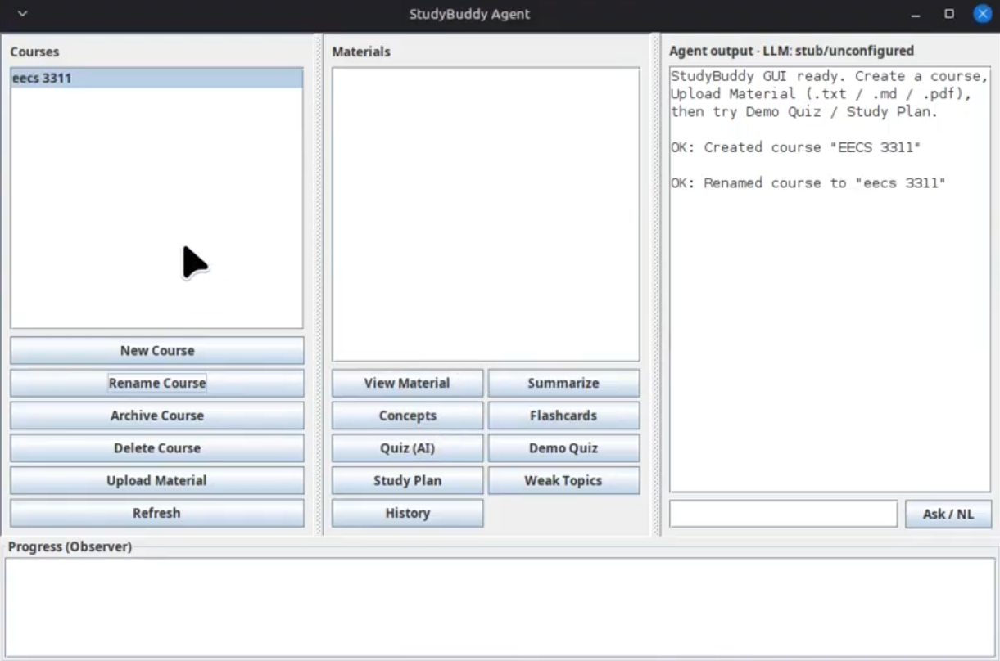
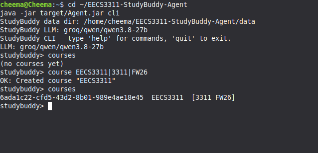

### F02 — Upload learning materials
- **Original requirement:** Upload student notes into a course.
- **How implemented:** `MaterialImportTool` extracts text from `.txt` / `.md` / `.pdf` (Apache PDFBox) and saves a `Material` linked to the course.
- **Differs from Stage 1?** Slightly — Stage 1 emphasized text notes; Stage 2 explicitly added **PDF** extraction so TAs can upload PDFs as well as sample TXT.
- **Screenshots:**
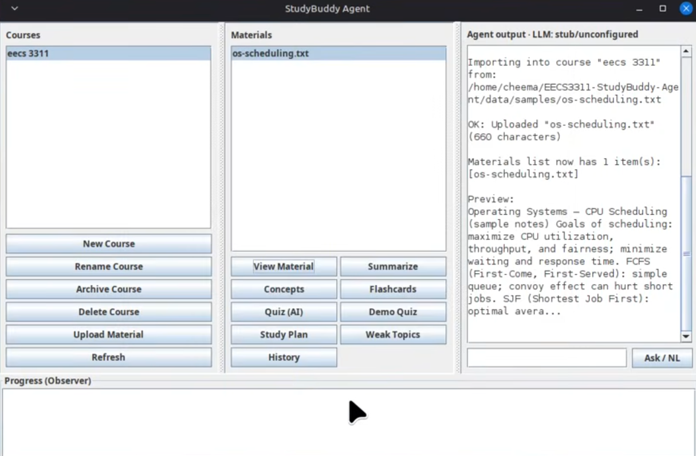
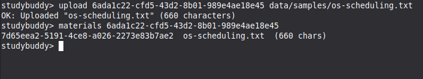

### F03 — Summarize
- **Original requirement:** Summarize uploaded materials with the LLM.
- **How implemented:** `SummarizeTool` builds a prompt via `PromptBuilder`, calls Strategy `LLMClient.generate`, stores the summary on the `Material`, prints full text in GUI/CLI.
- **Differs from Stage 1?** Provider only — Stage 1 assumed local Ollama; Stage 2 defaults to **Groq** (same `LLMClient` Strategy). Ollama remains available via `.env`.
- **Screenshots:**
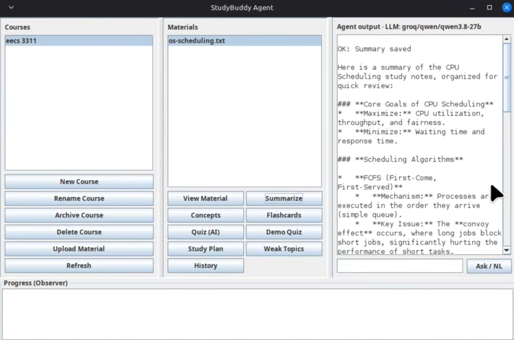
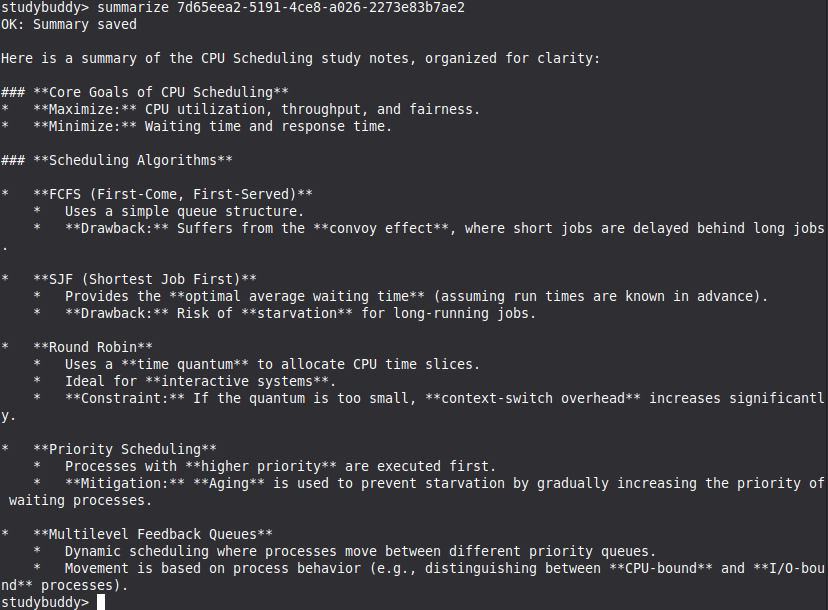

### F04 — Concept extraction
- **Original requirement:** Extract key concepts from materials.
- **How implemented:** `ConceptTool` → LLM → parse lines → `saveConcepts` on the material; GUI/CLI list the concepts.
- **Differs from Stage 1?** Same as F03 (Groq Strategy instead of Ollama-only). Behavior unchanged.
- **Screenshots:**
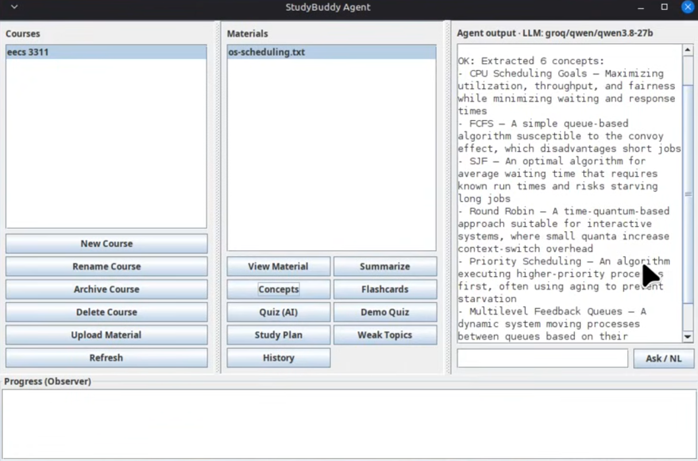
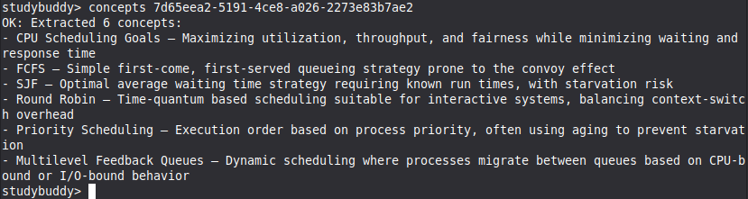

### F05 — Q&A over materials
- **Original requirement:** Answer questions using the student’s notes.
- **How implemented:** `RetrievalTool.retrieve` (keyword overlap) selects relevant material text → QA prompt → LLM answer. CLI also accepts free-form questions via the planner.
- **Differs from Stage 1?** Same feature; retrieval is **keyword** not embeddings (documented limitation — keeps the stack simple for the course).
- **Screenshots:**
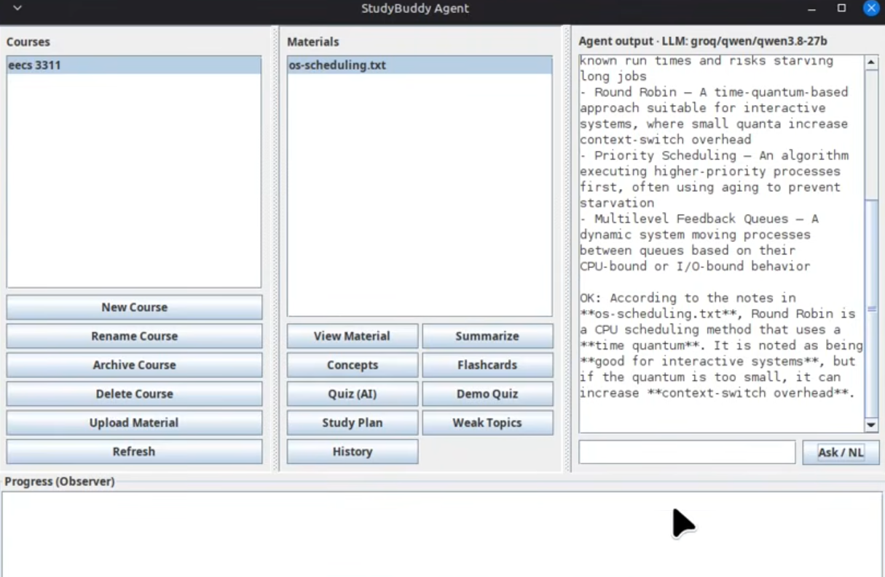
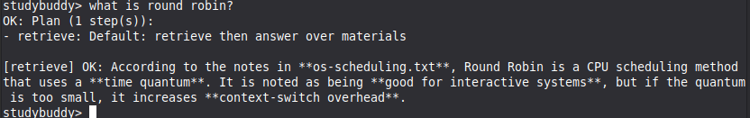

### F06 — Study plan
- **Original requirement:** Generate a multi-session study plan (optionally using weak topics).
- **How implemented:** `StudyPlanTool` reads weak topics + exam horizon; tries LLM plan, otherwise **deterministic fallback** sessions so the feature works without an API key.
- **Differs from Stage 1?** Added reliable offline fallback so demos/grading never depend on LLM uptime; AI path still used when configured.
- **Screenshots:**
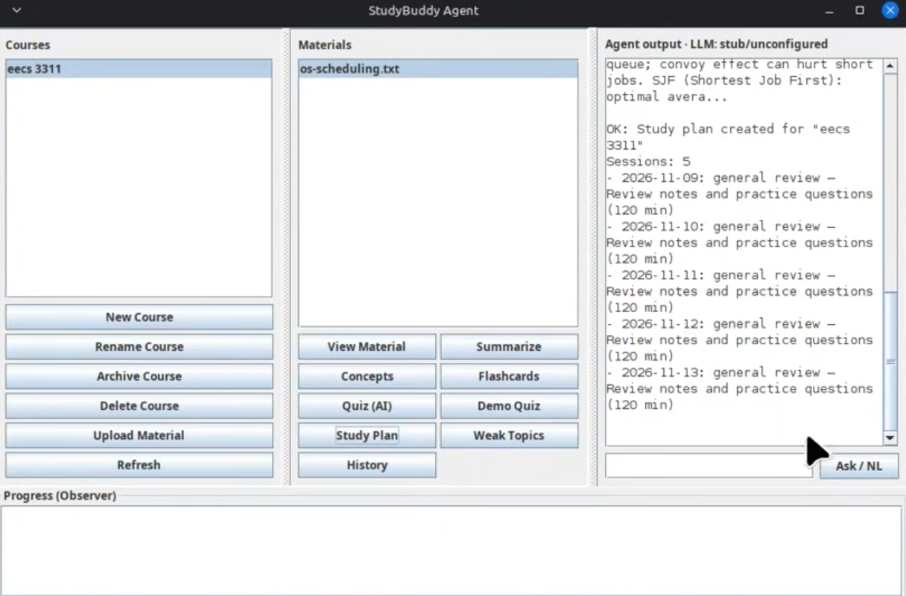
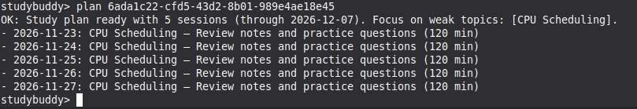

### F07 — Flashcards
- **Original requirement:** Generate flashcards from materials.
- **How implemented:** `FlashcardTool` → LLM → parse Q/A cards → GUI review / CLI list (`flashcards`).
- **Differs from Stage 1?** Provider only (Groq Strategy). Feature intent unchanged.
- **Screenshots:**
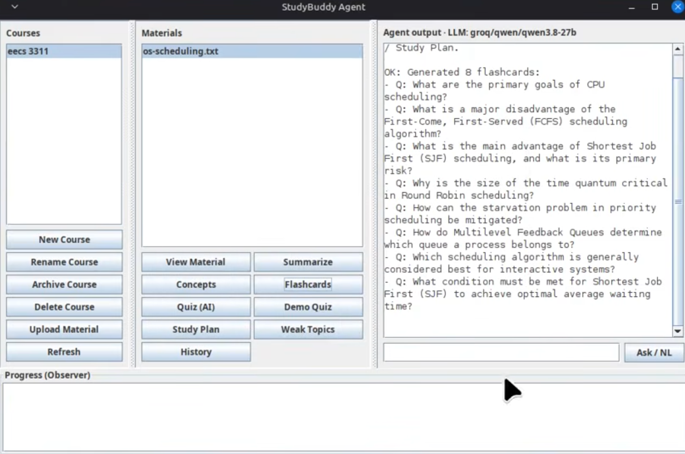
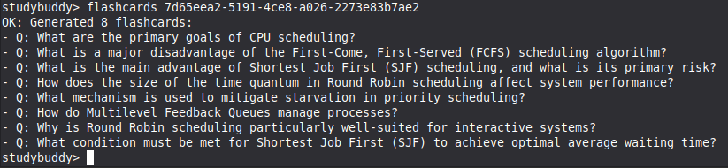

### F08 — Quiz generation (two paths: Demo Quiz vs Quiz AI)

#### F08a — Demo Quiz (deterministic, no LLM)
- **Original requirement:** Part of F08 quiz capability; offline/reliable path added in Stage 2.
- **How implemented:** GUI **Demo Quiz** / CLI `demo-quiz` → `AgentController.createDemoQuiz` → Factory Method MCQs on CPU scheduling.
- **Differs from Stage 1?** New offline path so TAs can run quizzes without an API key.
- **Screenshots (Demo Quiz):**
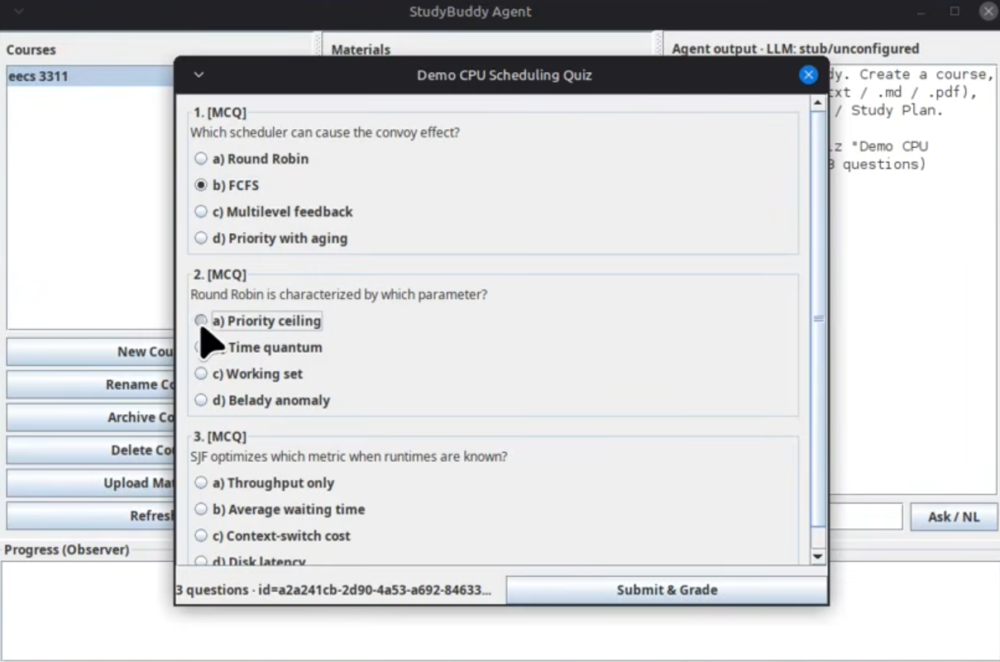
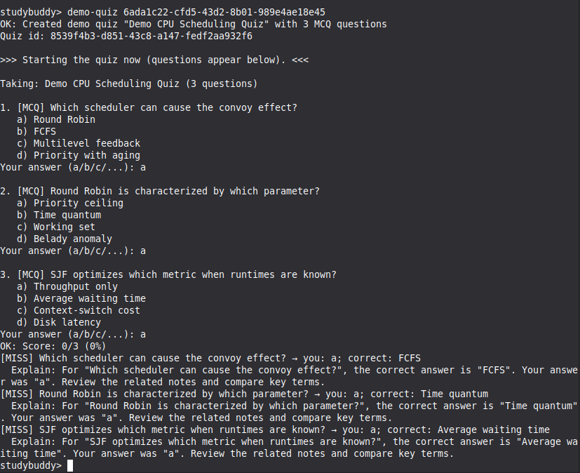

#### F08b — Quiz (AI)
- **Original requirement:** Generate quizzes from materials via LLM (Factory Method for question types).
- **How implemented:** GUI **Quiz (AI)** / CLI `quiz` → `QuizTool` → LLM → `QuizFactory` products.
- **Differs from Stage 1?** Provider only (Groq Strategy); feature intent unchanged.
- **Screenshots (Quiz AI):**
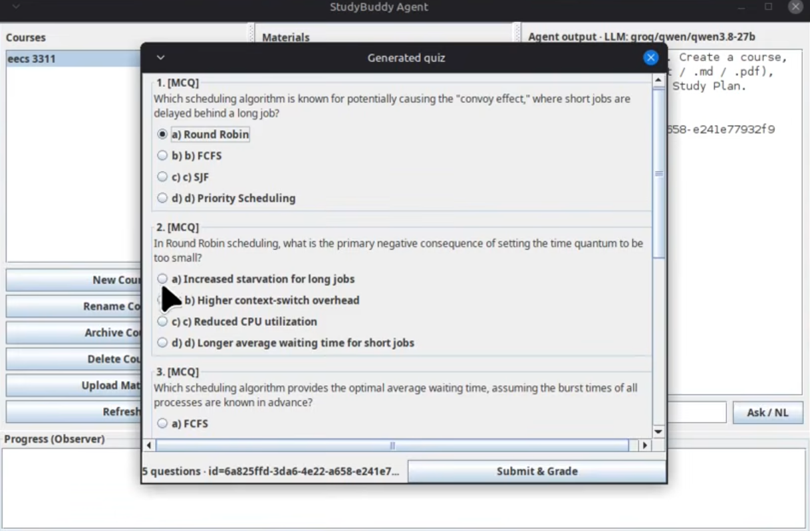
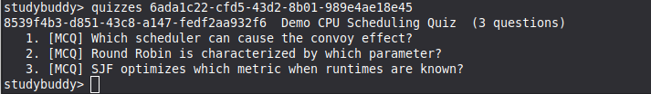

### F09 — Grade + explain (two paths: Demo Quiz grade vs Quiz AI grade)

#### F09a — Grade Demo Quiz
- **Original requirement:** Grade answers and explain misses (applied to the Demo Quiz).
- **How implemented:** Submit Demo Quiz → `QuizEngine.grade` → `ExplainTool` → `ProgressTracker.record` (Observer).
- **Differs from Stage 1?** No — same grading pipeline; input quiz is the deterministic Demo Quiz.
- **Screenshots (Demo Quiz grade):**
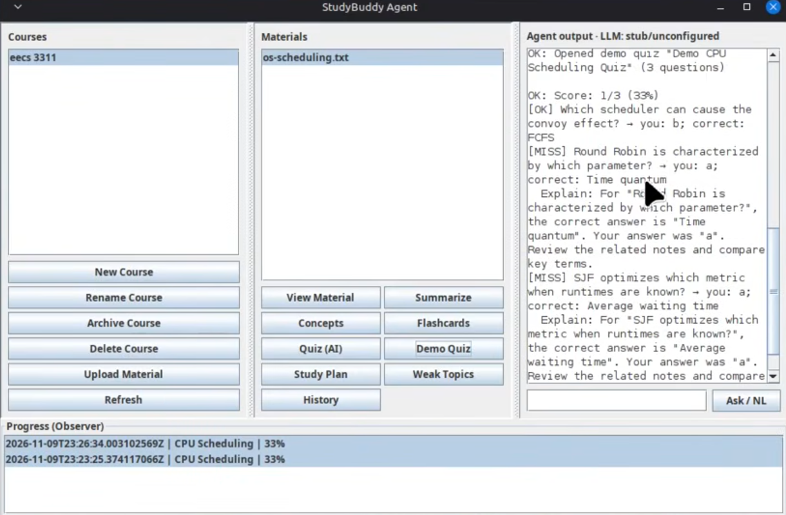
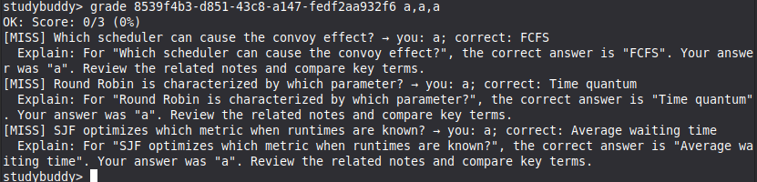

#### F09b — Grade Quiz (AI)
- **Original requirement:** Grade answers and explain misses (applied to an AI-generated quiz).
- **How implemented:** Submit Quiz (AI) → same `QuizEngine` / `ExplainTool` / `ProgressTracker` path as F09a.
- **Differs from Stage 1?** No — same grading pipeline; input quiz comes from F08b.
- **Screenshots (Quiz AI grade):**
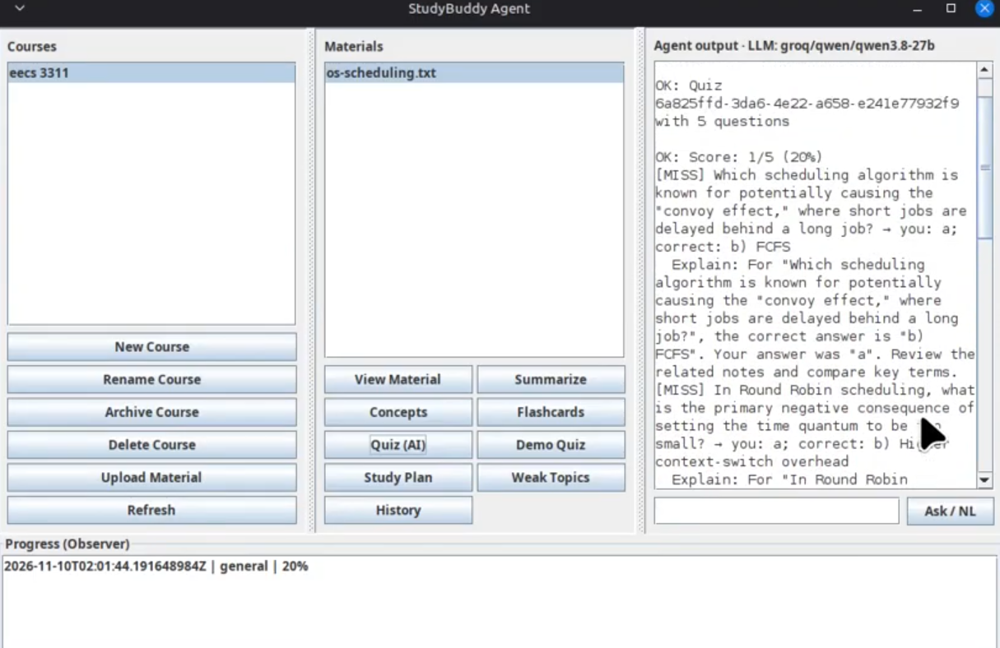
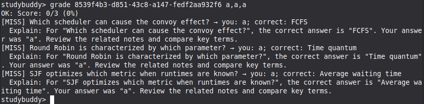

### F10 — Weak topics
- **Original requirement:** Identify weak topics from quiz performance.
- **How implemented:** `ProgressTracker.weakTopics(courseId)` aggregates low scores by topic; GUI button / CLI `weak`.
- **Differs from Stage 1?** No.
- **Screenshots:**
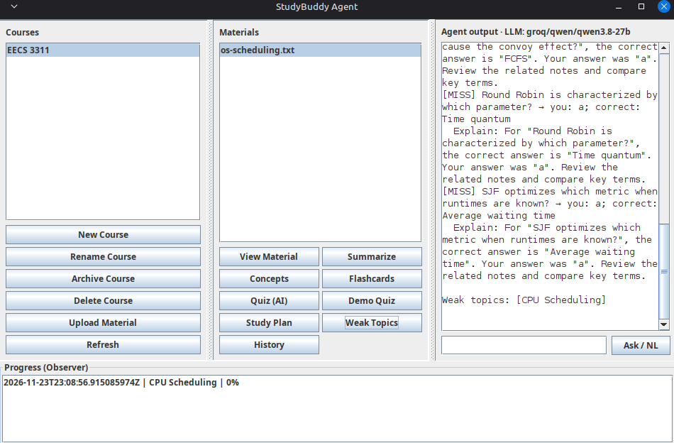
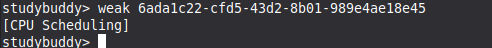

### F11 — Progress history
- **Original requirement:** Show history of quiz attempts / scores.
- **How implemented:** `ProgressTracker.history` reads persisted `progress.json`; GUI History / CLI `history`.
- **Differs from Stage 1?** Persistence file path clarified (`data/progress.json`); behavior matches Stage 1 Observer design.
- **Screenshots:**
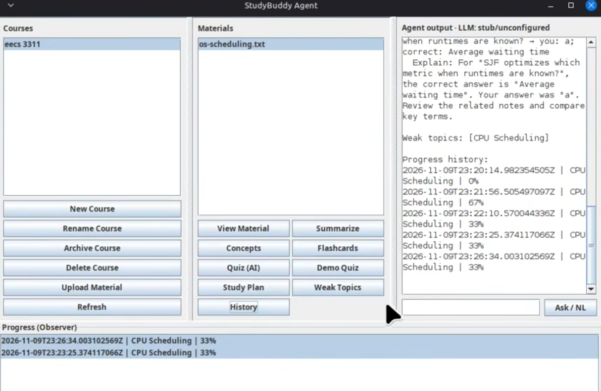
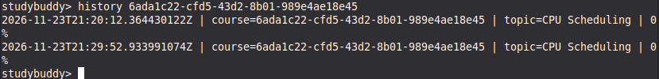

### F12 — Natural-language multi-step commands
- **Original requirement:** Accept NL requests that may chain tools (e.g. summarize then flashcards).
- **How implemented:** `Planner.parse` → `AgentController.handleRequest` → `ToolManager` runs ordered tools; GUI **Ask / NL** and CLI `nl …`.
- **Differs from Stage 1?** No.
- **Screenshots:**
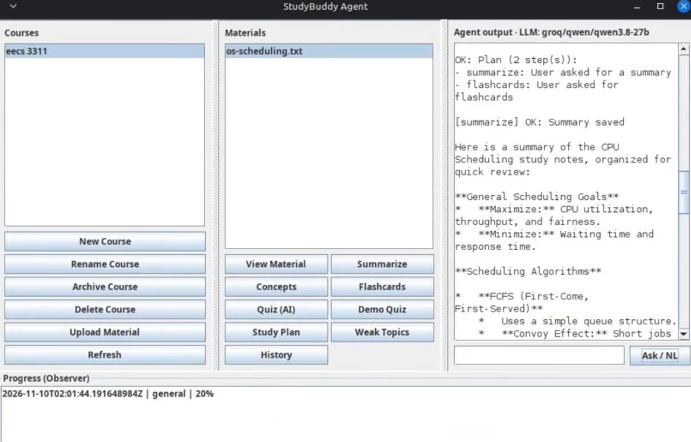
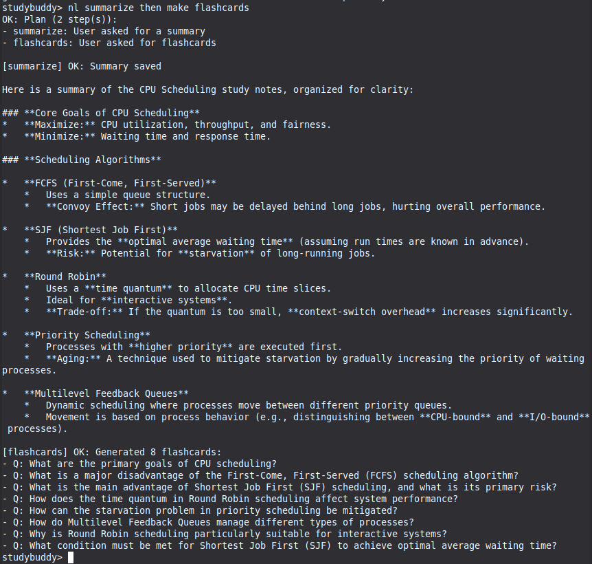

### Standalone CLI batch (Stage 2/3 addition)
- **Original Stage 1 requirement:** Terminal CLI as a view (interactive).
- **How implemented in Stage 2:** Fat `Agent.jar` + `-LLMAPI -input examples/task.txt` batch mode with `$COURSE` / `$MATERIAL` / `$QUIZ` placeholders (professor example).
- **Why changed:** Required for Stage 2 update + Stage 3 automation; same `StudyCLI` → `AgentController` stack as interactive mode.

---

## 9. Standalone CLI (file / stdin / terminal)

**Build:** `mvn -q -DskipTests package` → `target/Agent.jar`

**Run task file (matches instructor example style):**

```bash
java -jar target/Agent.jar -LLMAPI -input examples/task.txt
```

**Options:** `gui` | `cli` | `-input <file>` | `-LLMAPI` | `help` (see README).  
**Placeholders in task files:** `$COURSE`, `$MATERIAL`, `$QUIZ`.  
**Working example file:** `examples/task.txt`.

This CLI is required for Stage 3 automation; interactive and batch modes share `StudyCLI` → `AgentController`.
